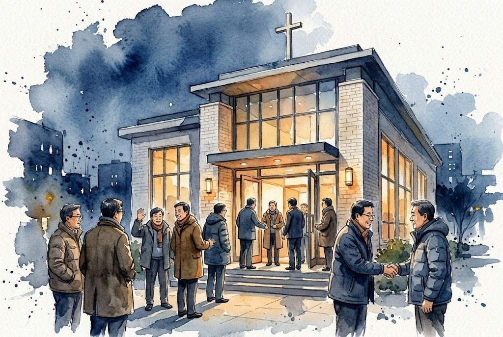
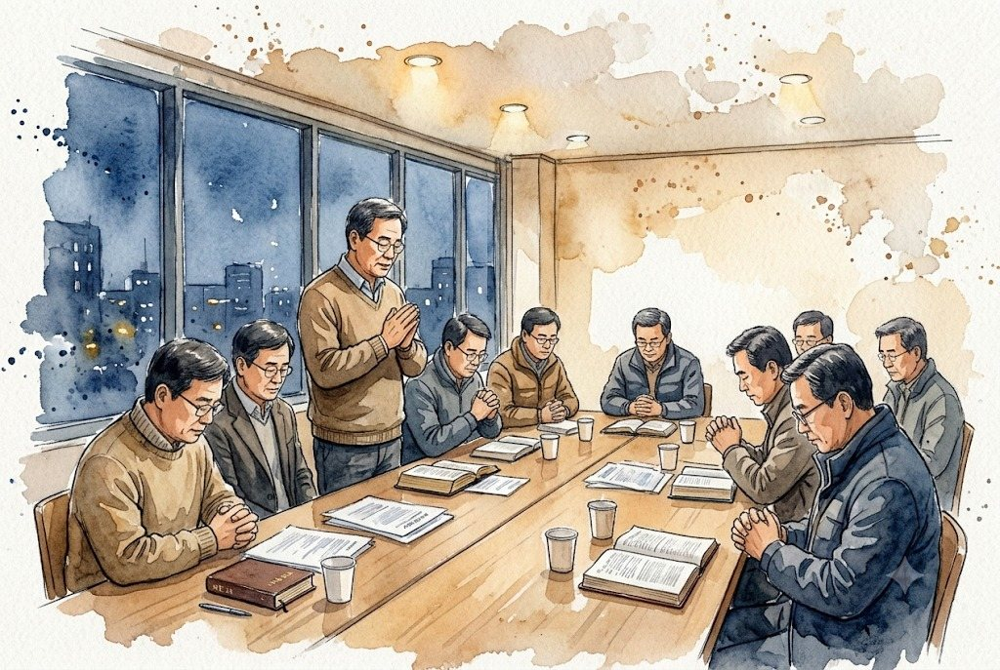
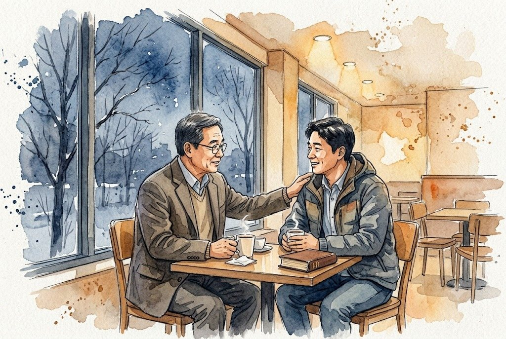
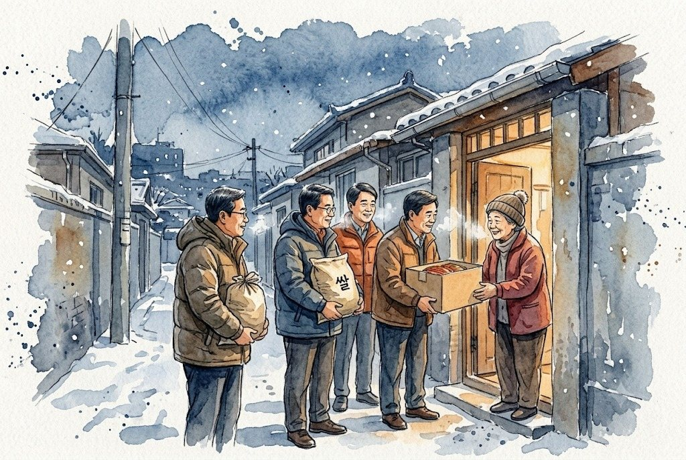
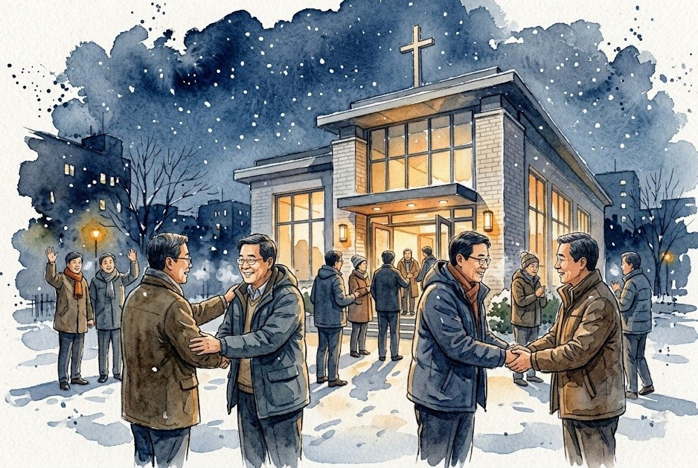

title: 남전도회 총회 대표기도문 — 한 해를 마무리하며 드리는 그림이 있는 기도
description: 남전도회(남선교회) 연말 총회·월례회에서 읽는 2분 분량 대표기도문입니다. 한 해의 감사, 이루지 못한 일에 대한 겸손한 고백, 새해의 화합과 젊은 회원, 회원 가정의 건강을 수채화 그림과 함께 담았습니다.
updated: 2026-11-14
---
<figure class="pic"><figcaption>한 해를 마무리하는 총회 날 저녁</figcaption></figure>

11월과 12월이 되면 남전도회도 한 해를 마무리하는 총회로 모입니다. 사업과 결산을 보고하고 새해 일꾼을 세우는 자리이지만, 그 앞에 드리는 기도는 회의보다 먼저 마음을 모으는 시간입니다. 잘한 일만 늘어놓기보다 감사와 아쉬움을 함께 주님 앞에 내려놓고, 새해에는 하나님의 뜻 안에서 지혜롭게 움직이자는 다짐을 담았습니다.

소리 내어 읽으면 약 2분입니다. 쉼표마다 한 번씩 숨을 고르며 읽으시면 됩니다. 교회 이름은 그대로 넣어 읽으셔도 좋습니다.

<h2>1. 한 해를 감사하며</h2>

<figure class="pic"><figcaption>총회를 열며 고개 숙인 회원들</figcaption></figure>

<b>한 해를 지키시고 인도하신 사랑의 하나님 아버지,</b>

올 한 해도 저희 남전도회를, 은혜 가운데 붙들어 주시고, 오늘 한 해를 마무리하는 총회로 모이게 하시니, 감사드립니다. 일터와 가정의 바쁜 형편 속에서도, 예배의 자리를 지키고, 교회의 크고 작은 일에 앞장서 땀 흘린 손길마다, 주님의 은혜가 함께하였음을 고백합니다. 한 해 동안 앞에서 섬긴 회장과 임원들의 수고를 기억하여 주시옵고, 말없이 뒤에서 힘을 보탠 회원들에게도, 하늘의 상급을 더하여 주시옵소서.

<h2>2. 아쉬움을 주님께 내려놓으며</h2>

<figure class="pic"><figcaption>믿음의 선배와 젊은 형제가 마주 앉은 자리</figcaption></figure>

<b>긍휼이 많으신 주님,</b> 한 해를 돌아보니 감사와 함께 아쉬움도 남습니다. 새로운 일을 꿈꾸고, 젊은 형제들과 함께할 날을 소망하였으나, 아직 그 열매를 다 거두지 못하였습니다. 바쁜 마음에 서로를 깊이 살피지 못하고, 지혜를 모으는 일에도 더디었습니다. 부족했던 저희를 주님의 사랑으로 품어 주시고, 새해에는 새 마음으로 시작하게 하여 주시옵소서.

<h2>3. 새해를 바라보며</h2>

<figure class="pic"><figcaption>섬김과 나눔으로 이어지는 새해</figcaption></figure>

<b>말씀으로 저희를 세우시는 주님,</b> 다가오는 새해에는 저희의 생각과 계획보다, 하나님의 뜻을 먼저 묻고, 그 뜻 안에서 지혜롭게 움직이는 남전도회가 되게 하여 주시옵소서. 말씀 위에 굳게 서서, 힘 있고 능력 있게 교회의 중심을 받치게 하시고, 생각이 다를 때에도 사랑으로 품어, 하나로 화합하게 하여 주시옵소서. 젊은 형제들이 기쁨으로 찾아와, 함께 어울리고 함께 섬기는 모임이 되게 하시고, 새해를 섬길 일꾼들에게는, 지혜와 담대함을 주시옵소서. 새해의 살림도 넉넉히 채워 주셔서, 선교와 구제, 섬김과 나눔의 활동이, 활기차게 이어지게 하여 주시옵소서.

<h2>4. 회원과 가정을 위하여</h2>

<figure class="pic"><figcaption>서로를 격려하며 돌아가는 밤</figcaption></figure>

찬 바람이 부는 계절에, 회원들과 그 가정의 건강을 지켜 주시옵고, 연약한 회원들은 속히 일으켜 주시옵소서. 일터에서 무거운 짐을 진 형제들에게는 새 힘을 주시고, 가정마다 웃음과 평안이 넘치게 하셔서, 새해에도 모두가, 교회의 든든한 일꾼으로 서게 하여 주시옵소서.

오늘 총회의 모든 순서를 성령께서 주관하여 주시옵고, 마치는 시간까지 서로 격려하며 기쁨으로 돌아가게 하여 주시옵소서. 이 모든 말씀, 우리 주 예수 그리스도의 이름으로 기도드립니다. 아멘.

<h2>우리 모임에 맞게 고쳐 쓰기</h2>

<ul>
<li><b>교회 이름 넣기.</b> 첫 단락의 "저희 남전도회를"을 "OO교회 남전도회를"로 바꾸어 읽으면 더 가깝게 들립니다.</li>
<li><b>남선교회라면.</b> "남전도회"만 "남선교회"로 바꾸면 그대로 쓸 수 있습니다. 여전도회·권사회라면 "형제들"을 "자매들"로 바꿉니다.</li>
<li><b>1분으로 줄이려면.</b> 2번 고백 단락과 4번 첫 문단을 한두 문장씩 남기고, 3번은 첫 문장과 마지막 문장만 읽으면 약 1분이 됩니다.</li>
<li><b>안건이 있다면.</b> 회칙 개정이나 회비 조정이 있다면 3번 단락 끝에 "오늘 다룰 안건도 서로 존중하는 마음으로 결정하게 하여 주시옵소서" 한 문장을 더합니다.</li>
<li><b>고백은 우리 모두의 이야기로.</b> 한 해의 아쉬움을 담을 때 특정 사람이나 사건이 떠오르는 표현은 피하고, "저희"가 함께 부족했다는 말로 씁니다. 총회 자리가 따뜻해집니다.</li>
</ul>

그림은 AI 이미지 도구로 만든 수채화입니다. 다른 기관의 총회 기도문은 <a href="/type/year-end/">연말 총회·송년 기도문 모음</a>에서, 날짜에 맞춘 남전도회 기도문은 <a href="/group/namjeondo/">남전도회 대표기도문 모음</a>에서 보실 수 있습니다.

