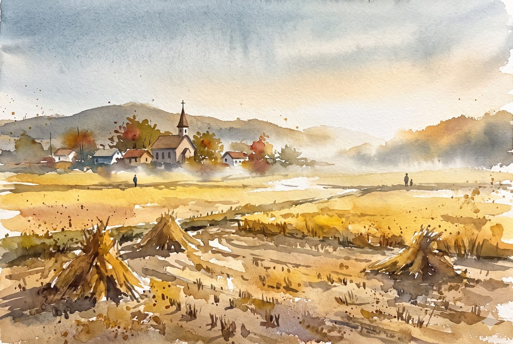
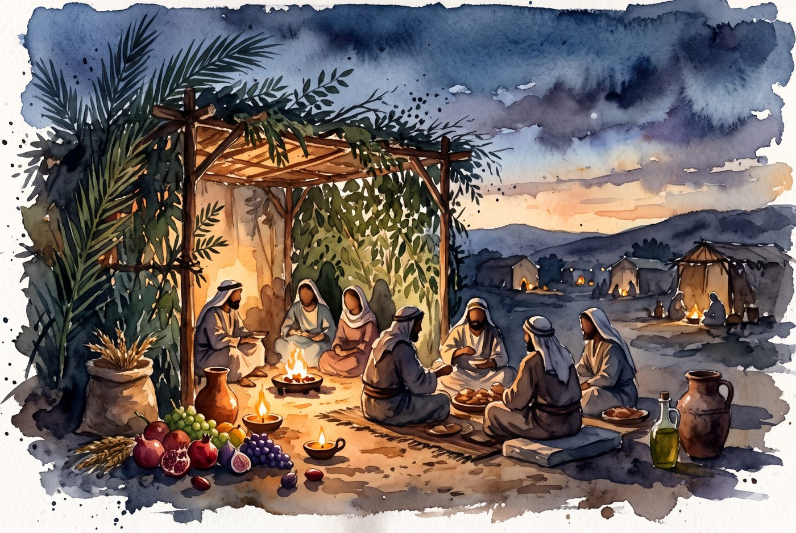
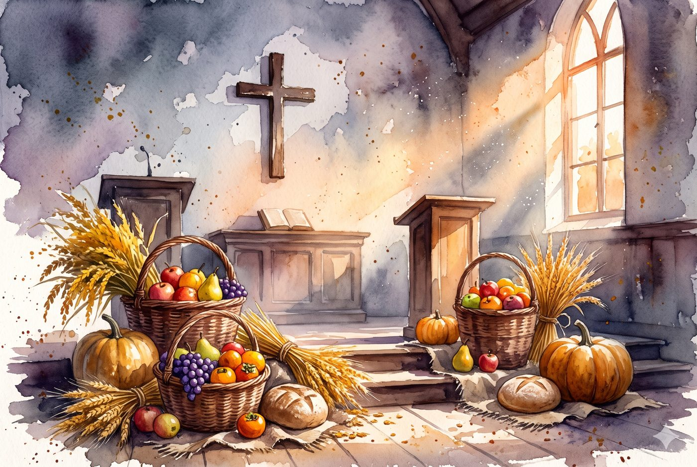
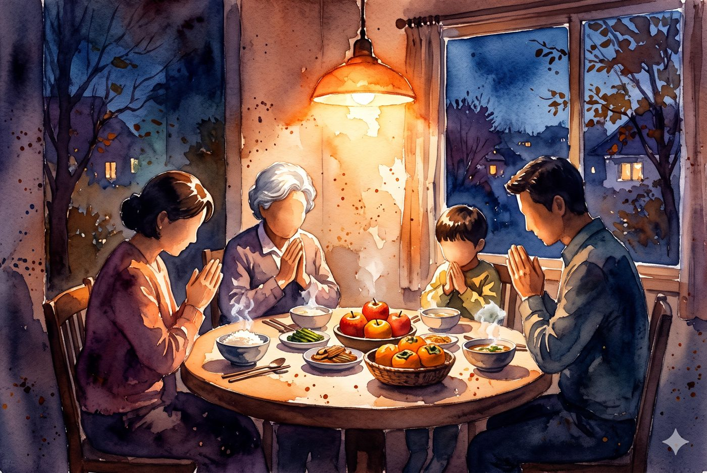
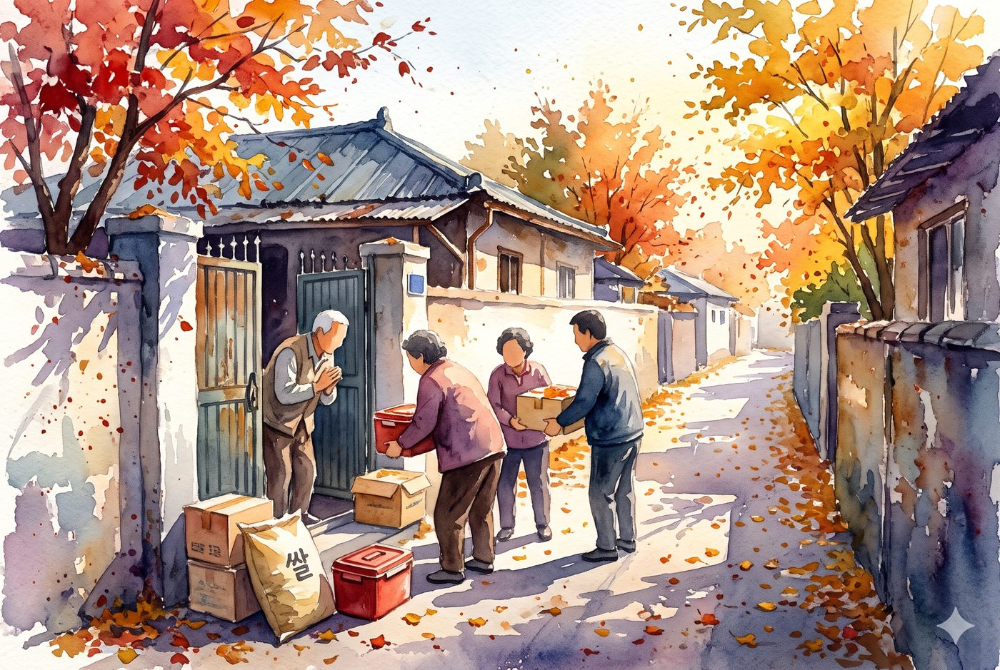

title: 추수감사절의 의미와 감사 기도문 — 거두게 하신 손길 앞에서
description: 추수감사절의 의미(성경의 초막절·수장절, 교회의 전통, 오늘 우리의 감사)와 감사하는 성도의 자세, 추수감사주일 예물 준비 기도와 가정에서 드리는 감사 기도문을 수채화 그림과 함께 정리했습니다.
updated: 2026-11-08
---
<figure class="pic"><figcaption>거두어들인 들녘 너머, 작은 교회</figcaption></figure>

11월이 되면 교회 강단 앞에 과일 바구니와 곡식 단이 놓입니다. 해마다 보는 풍경이지만 그 앞에 서면 묻게 됩니다. 나는 올 한 해, 무엇을 거두었는가. 그리고 그것은 정말 내가 거둔 것인가.

<h2>1. 추수감사절은 무엇인가</h2>

<figure class="pic"><figcaption>초막을 짓고 광야의 날들을 기억하던 이스라엘</figcaption></figure>

<b>성경의 감사 절기에서 시작합니다.</b> 하나님은 이스라엘에게 한 해의 소출을 거두어들인 뒤 일곱 날 동안 초막에 머물며 즐거워하라고 하셨습니다(레위기 23:39~43, 신명기 16:13~15). 초막절, 또는 수장절이라고 부르는 이 절기는 두 가지를 함께 기억하게 했습니다. 하나는 올해 주신 열매이고, 다른 하나는 집도 밭도 없던 광야 사십 년 동안 매일 먹이시고 입히신 은혜입니다.

<b>교회의 감사 전통으로 이어졌습니다.</b> 신대륙에 건너간 청교도들이 혹독한 첫 겨울을 지나 첫 수확을 거둔 뒤 하나님께 감사의 예배를 드린 일이 오늘의 추수감사절로 자리 잡았습니다. 한국 교회는 초기부터 이 감사 절기를 지켜 왔고, 많은 교회가 11월 셋째 주일을 추수감사주일로 지킵니다.

<figure class="pic"><figcaption>강단 앞에 놓인 감사의 예물</figcaption></figure>

<b>열매의 주인을 고백하는 날입니다.</b> 농사를 짓지 않는 우리에게 추수란 한 해 동안 받은 모든 것입니다. 일터와 월급, 건강과 가족, 지켜 주신 시간과 견딜 힘이 모두 열매입니다. 추수감사절은 그 열매를 내가 만든 것이 아니라 하나님께서 맡겨 주신 것이라고 고백하는 날입니다.

<b>감사가 나눔이 되는 날입니다.</b> 성경의 초막절에는 레위인과 나그네와 고아와 과부도 함께 즐거워하게 하라고 하셨습니다(신명기 16:14). 감사는 내 곳간을 채우는 데서 끝나지 않고, 이웃의 빈 그릇으로 흘러갈 때 완성됩니다.

<h2>2. 감사하는 성도의 자세</h2>

<figure class="pic"><figcaption>식탁에 둘러앉아 감사를 나누는 가족</figcaption></figure>

<ul>
<li><b>헤아립니다.</b> 막연히 "감사합니다"보다, 올해 받은 은혜를 하나씩 적어 봅니다. 열 가지를 넘기면 감사의 목소리가 달라집니다.</li>
<li><b>모든 형편에서 감사합니다.</b> 성경은 범사에 감사하라고 합니다(데살로니가전서 5:18). 잘된 일만이 아니라 아팠던 일, 잃은 것 속에서도 함께하신 하나님을 찾습니다.</li>
<li><b>먼저 드립니다.</b> 감사 예물은 남은 것이 아니라 처음 것으로 준비합니다. 액수보다 마음의 순서가 중요합니다.</li>
<li><b>입술로 고백합니다.</b> 가족과 성도에게 받은 은혜를 말로 나눕니다. 감사는 말할수록 커집니다.</li>
<li><b>나눕니다.</b> 감사의 한 부분을 이웃을 위해 떼어 놓습니다. 쌀 한 포대, 김치 한 통, 안부 전화 한 통도 좋습니다.</li>
</ul>

<h2>3. 추수감사 예물을 준비하며 드리는 기도</h2>

<figure class="pic"><figcaption>성경 위에 놓인 감사의 예물</figcaption></figure>

<b>한 해의 열매를 허락하신 하나님 아버지,</b>

올해도 저희의 걸음을 지켜 주시고, 일터와 가정과 교회에서 은혜를 넘치게 부어 주셨사오니 감사드립니다. 저희가 거둔 모든 것이 저희 손의 힘이 아니라 하나님께서 주신 것임을 고백합니다.

이제 감사의 예물을 준비하오니, 남은 것이 아니라 처음 것을 드리게 하시고, 액수보다 마음을 먼저 드리게 하여 주시옵소서. 힘든 한 해를 보낸 성도들도 그 가운데 함께하신 주님을 발견하여, 눈물 섞인 감사를 드릴 수 있게 하여 주시옵소서.

이 예물이 교회를 세우고 이웃을 살리는 일에 귀하게 쓰이게 하시며, 드리는 저희 손에도 기쁨이 넘치게 하여 주시옵소서. 이 모든 말씀, 우리 주 예수 그리스도의 이름으로 기도드립니다. 아멘.

<h2>4. 가정에서 드리는 추수감사 기도</h2>

<figure class="pic"><figcaption>감사가 이웃에게로 흘러가는 길</figcaption></figure>

<b>날마다 저희 식탁을 채우시는 하나님,</b>

올 한 해 저희 가족에게 일용할 양식을 주시고, 함께 웃고 함께 견딜 수 있게 하셨사오니 감사드립니다. 아플 때 회복을 주시고, 막막할 때 길을 열어 주시고, 서로를 다시 사랑하게 하신 은혜를 하나하나 기억합니다.

저희가 받은 감사가 저희 집 안에만 머물지 않게 하시고, 외로운 이웃과 어려운 가정에 흘러가게 하여 주시옵소서. 내년에도 이 식탁에 감사의 고백이 끊이지 않게 하여 주시옵소서.

우리 주 예수 그리스도의 이름으로 기도드립니다. 아멘.

그림은 AI 이미지 도구로 만든 수채화입니다. 추수감사주일 예배의 대표기도문은 <a href="/p/anytime/season-thanksgiving/">해마다 쓰는 추수감사주일 대표기도문</a>과 <a href="/season/thanksgiving/">추수감사 기도문 모음</a>에서 보실 수 있습니다. 성찬이 있는 주일이라면 <a href="/communion/">성찬식의 의미와 성찬 기도문</a>도 함께 보세요.

